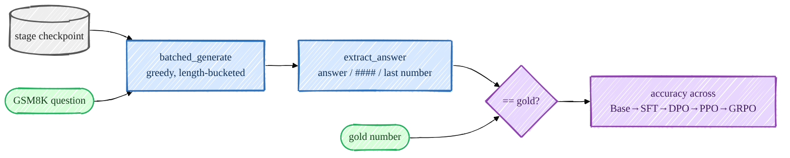
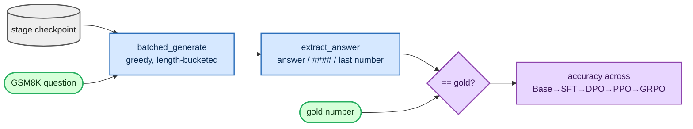

<!-- omit in toc -->
# Evaluation

A pipeline is only believable if you can measure it, so I evaluate every stage on the **same** held-out
GSM8K test set with greedy decoding. The headline deliverable is a single table: GSM8K accuracy as it
moves Base → SFT → DPO → PPO → GRPO. The reward is *verifiable* (I parse the model's final number and
compare it to the gold answer), so the score is objective, not a judgment call.



<details>
<summary>Mermaid source (live, editable)</summary>



</details>

## Generation: length-bucketed, greedy

The educational model has no padding-aware attention mask, so
[`batched_generate`](https://github.com/FareedKhan-dev/train-llm-from-scratch/blob/main/src/post_training/evaluation.py#L24) groups prompts of equal length and decodes
each bucket together; `greedy=True` forces argmax (`top_k=1`) for comparable, deterministic numbers.

## Scoring: a verifiable reward

[`gsm8k_accuracy`](https://github.com/FareedKhan-dev/train-llm-from-scratch/blob/main/src/post_training/evaluation.py#L77) generates an answer per question and checks
it with the verifier:

```python
prompts = [encode_prompt([{"role": "user", "content": q}]) for q, _ in qa_pairs]
responses = batched_generate(model, prompts, max_new_tokens, device=device, greedy=greedy)
correct = sum(is_correct(resp, gsm8k_gold_answer(ans)) for (q, ans), resp in zip(qa_pairs, responses))
```

The reward/checker lives in [`rewards/`](https://github.com/FareedKhan-dev/train-llm-from-scratch/blob/main/src/post_training/rewards/). `extract_answer` is tolerant:
it prefers an `<answer>…</answer>` tag, then a GSM8K-style `#### N`, then falls back to the last number
in the text. [`reward_gsm8k`](https://github.com/FareedKhan-dev/train-llm-from-scratch/blob/main/src/post_training/rewards/verifiers.py#L35) is
**correctness-dominant** with only a small, bounded format bonus, to discourage reward hacking:

```python
r = 0.0
if _answers_match(extract_answer(text), gold): r += 1.0     # the reward that matters
if has_well_formed_answer(text):               r += 0.2     # small format nudge
return min(r, 1.2)                                           # clipped
```

I sanity-checked this scorer independently of any model: feeding it correct answers scores **100/100**
and wrong answers **0/100** false positives, with gold cross-verified against the live GSM8K dataset.

## The across-stages table

[`eval_post_training.py`](https://github.com/FareedKhan-dev/train-llm-from-scratch/blob/main/scripts/eval_post_training.py) loads any checkpoint (reading its dims from
the stored `cfg`), scores it, and appends a row to a JSONL you can render as a table:

```bash
for s in base_pretrained sft dpo ppo grpo; do
  python scripts/eval_post_training.py --ckpt models/$s.pt \
    --label $s --limit 200 --append logs/stage_table.jsonl
done
python scripts/eval_post_training.py --table logs/stage_table.jsonl
```

```
stage              GSM8K acc       n
------------------------------------
base_pretrained         ...      200
sft                     ...      200
dpo                     ...      200
ppo                     ...      200
grpo                    ...      200
```

## The base model on standard benchmarks

GSM8K needs the chat format, so it says little about a base model straight out of pretraining.
[`scripts/eval_base.py`](https://github.com/FareedKhan-dev/train-llm-from-scratch/blob/main/scripts/eval_base.py)
scores any checkpoint the way base models are compared: the model is asked how likely each
candidate answer is, with no generation.

```bash
python scripts/eval_base.py --ckpt models/base_pretrained.pt
python scripts/eval_base.py --hf_model openai-community/gpt2   # a reference point
```

| task | what it measures | metrics | chance |
|---|---|---|---|
| ARC-Easy, ARC-Challenge | science questions, 3 to 5 answers | `acc` (total log-probability), `acc_norm` (per character) | about 25% |
| LAMBADA | the last word of a passage that needs the whole passage | `acc` (greedy decoding is exactly right), perplexity | 0% |

The log-likelihood of an answer is the sum, over its tokens, of the log-probability of each
token given everything before it:

$$
\log p(\text{answer} \mid \text{question}) = \sum_{t \in \text{answer}} \log p(x_t \mid x_{<t})
$$

The prompts, the tokenization at the boundary, the truncation to the model's window and the
normalization follow EleutherAI's lm-evaluation-harness exactly
([`src/benchmarks/`](https://github.com/FareedKhan-dev/train-llm-from-scratch/tree/main/src/benchmarks)),
so the numbers compare with published ones. On GPT-2 124M it gives ARC-Easy 43.81 / 39.48,
ARC-Challenge 19.03 / 22.70 (acc / acc_norm) and LAMBADA 32.56% at perplexity 40.06.
HellaSwag is not included: its source repository was taken down by a DMCA notice in
September 2026.

## In-training metrics

Each trainer also writes a metrics JSONL under `logs/` (via
[`MetricsLogger`](https://github.com/FareedKhan-dev/train-llm-from-scratch/blob/main/src/post_training/logging_utils.py)): train/dev loss for SFT, preference accuracy
for the reward model, implicit-reward accuracy for DPO, and reward/KL/clip-fraction + GSM8K accuracy for
PPO/GRPO. Pass `--use_wandb true` to also mirror to Weights & Biases; the JSONL is always written so you
can plot offline.

## What "good" looks like at this scale

A ~400M from-scratch model won't top the GSM8K leaderboard. The point is the **relative** climb across
stages and bounded KL during RL. Expect modest absolute numbers but a clear, real before/after gain at
each step.

➡️ Next: [talk to any checkpoint](09_inference.md).
